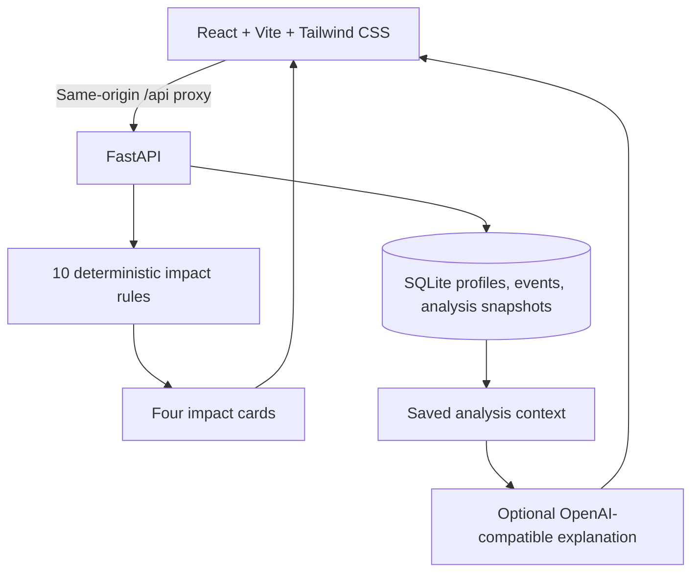

# Aura Finance

**Finance Impact Copilot | HackUTD**

Aura Finance connects economic events to personal financial circumstances through
a rule-based impact dashboard and optional AI explanations.

> Economic news tells you what happened. Aura Finance helps you understand what
> it could mean for your money.

**Theme:** Artificial Intelligence + Financial Literacy + Economic Intelligence
+ Personalized Decision Support.

**Status:** Local hackathon MVP implemented. This is an educational prototype,
not a commercially deployed financial service.

## The problem

People hear about inflation, interest rates, jobs reports, and housing trends,
but often struggle to understand their relevance to their income, business,
investments, or property. Aura Finance makes those relationships understandable
without claiming to predict anyone's financial future.

Target users include students, retail investors, small business owners, and
homeowners exploring economic scenarios.

## Four features, one demo

| Feature | Implemented behavior |
|---|---|
| Demo financial profile | Occupation, income range, and business, investment, and property exposure; no account required |
| Economic event selector | Four hypothetical events: inflation up, interest rate increase, strong jobs report, and housing slowdown |
| Impact engine | Ten deterministic business rules produce four impact cards with attention labels, explanations, and considerations |
| AI explanation | Follow-up questions grounded in a saved analysis through an OpenAI-compatible API |

Profiles and analysis snapshots are stored in SQLite. Changing the profile or
event clears the old dashboard so results cannot be mistaken for a new scenario.

**Without an AI key:** the entire profile-to-dashboard workflow still works.
The app explicitly labels AI as unconfigured and disables AI questions. It never
substitutes a fake AI response.

**With an AI key:** the backend sends the saved event, profile context, business
rules, assumptions, and question to the configured provider. Names and database
metadata are omitted. Provider errors are shown explicitly.

## Quick start

Prerequisites: **Python 3.11+** and **Node.js 22+** with npm.
Commands below use a macOS/Linux shell.

```bash
git clone https://github.com/phuongcodes2025-sys/aura-finance.git
cd aura-finance
```

### 1. Start the backend

```bash
cd backend
python3 -m venv .venv
source .venv/bin/activate
python -m pip install -r requirements.txt
cp .env.example .env
uvicorn app.main:app --reload --env-file .env --host 127.0.0.1 --port 8000
```

Leave `OPENAI_API_KEY` empty to try the rule-based demo. For AI explanations,
edit `backend/.env` and restart the backend:

```dotenv
DATABASE_PATH=./aura.sqlite3
OPENAI_API_KEY=your-provider-key
OPENAI_BASE_URL=https://api.openai.com/v1
OPENAI_MODEL=gpt-4o-mini
```

For another OpenAI-compatible provider, use its base URL and supported model.
The integration uses `/chat/completions` with `max_tokens`; your provider must
support that interface. A configured key does not guarantee provider access,
quota, or model availability.

### 2. Start the frontend in a second terminal

From the repository root:

```bash
cd frontend
npm ci
npm run dev
```

Open **http://127.0.0.1:5173**.
API documentation is at **http://127.0.0.1:8000/docs**.

Vite proxies `/api` to the backend on port 8000, keeping requests same-origin.
There is no need to configure browser CORS or expose AI credentials to React.

### Production-build preview

With the backend still running:

```bash
cd frontend
npm run build
npm run preview
```

Open **http://127.0.0.1:4173**. The preview server also proxies `/api` locally.
This is a build preview, not a production deployment configuration.

## A three-minute judge demo

| Time | Story and action |
|---|---|
| 0:00-0:30 | Explain the gap: "I hear economic news, but what does it mean for me?" |
| 0:30-1:00 | Click **Use Dallas business owner demo**; the profile includes investment and rental-property exposure and selects a rate increase |
| 1:00-1:45 | Click **Analyze impact**; walk through income, business, investments, and real estate |
| 1:45-2:30 | With AI configured, ask "Why should my business pay attention to higher interest rates?" |
| 2:30-3:00 | Open the assumptions; explain that rules determine labels, AI explains them, and no live data or guaranteed predictions are involved |

The core click-through requires only loading the demo profile and clicking
Analyze. The form captures broad investment exposure, not specific holdings such
as NVDA; do not imply a ticker-level portfolio analysis.

## How the rules work

`backend/app/impact.py` contains four curated event descriptions and exactly ten
rules. A rule can cover multiple related events. Each supported event matches
exactly one rule per active financial area.

- Income always receives an analysis.
- Unselected business, investment, or property exposure is **Not applicable**.
- Active areas receive **Low**, **Moderate**, or **High attention** labels.
- Every active card includes its rule ID, reasoning, and suggested considerations.
- Income range and occupation provide context, not dollar calculations or score adjustments.

Labels express qualitative educational attention, not loss probabilities or
personalized risk measurements. For example, a rate increase does not
automatically change an existing fixed-rate mortgage payment. The rules explicitly
distinguish that from new or variable-rate financing.

The AI does not perform financial calculations or choose the rule-based labels.
Its prompt instructs it to preserve the supplied labels, explain uncertainty,
avoid specific trading recommendations, and stay within the scenario.
AI outputs still require verification.

## Architecture



Frontend and backend are separated to keep JavaScript UI code and Python API
code easy to run independently. There are no microservices or multiple AI agents.

```text
aura-finance/
├── README.md
├── backend/
│   ├── .env.example
│   ├── requirements.txt
│   ├── requirements-dev.txt
│   ├── app/
│   │   ├── main.py         # Routes, configuration, startup
│   │   ├── models.py       # Validated API contracts
│   │   ├── database.py     # SQLite persistence
│   │   ├── impact.py       # Four events and ten business rules
│   │   └── advisor.py      # Contextual AI integration
│   └── tests/
└── frontend/
    ├── package.json
    ├── package-lock.json
    ├── vite.config.ts
    └── src/
        ├── App.tsx         # Profile, events, cards, and AI Q&A
        ├── api.ts          # Typed API calls and visible errors
        ├── styles.css     # Responsive interface with Tailwind support
        └── App.test.tsx
```

### Storage

| Table | Stored information |
|---|---|
| `users` | Demo name, occupation, income range, exposure flags, timestamp |
| `economic_events` | Four seeded event IDs, titles, categories, descriptions |
| `analysis_results` | Profile/event references, timestamp, complete JSON snapshot |

Tables are created on startup and events are seeded idempotently. Foreign keys
are enabled. JSON snapshots preserve the exact profile, event, rules, and
assumptions used for later AI questions.

The database is created at `DATABASE_PATH`, relative to the backend working
directory by default. Database files and environment secrets are gitignored.

## API

All JSON fields use camelCase. Invalid inputs return `422`; unknown profiles,
events, or analyses return `404`.

| Method | Path | Purpose |
|---|---|---|
| GET | `/api/health` | Backend readiness and whether AI credentials are configured |
| GET | `/api/events` | List the four demo scenarios |
| POST | `/api/profile` | Save a demo profile; returns `201` |
| POST | `/api/analyze` | Apply rules and save an analysis; returns `201` |
| GET | `/api/analysis/{id}` | Retrieve the saved analysis snapshot |
| POST | `/api/chat` | Explain a question using an existing analysis |

Create a profile:

```json
{
  "name": "Dallas demo",
  "occupation": "Small business owner",
  "incomeRange": "60k-100k",
  "businessOwner": true,
  "investor": true,
  "propertyOwner": true
}
```

Supported income ranges: `under-30k`, `30k-60k`, `60k-100k`, and `over-100k`.
`name` is optional; the remaining profile fields are required.

Analyze using the returned profile ID:

```json
{ "userId": 1, "eventId": 2 }
```

Ask AI using the returned analysis ID:

```json
{
  "analysisId": 1,
  "question": "Why should my business pay attention to higher rates?"
}
```

Chat returns `{ "answer": "...", "source": "ai" }`. A missing AI key returns `503`;
provider connection, rejection, or malformed-output failures return `502`;
provider timeouts return `504`. No failure is presented as a successful AI answer.

## Validation

Backend tests:

```bash
cd backend
source .venv/bin/activate
python -m pip install -r requirements-dev.txt
python -m pytest -q
```

Frontend tests and type-checked production build:

```bash
cd frontend
npm test
npm run build
```

Backend tests cover all four events, all eight exposure combinations, and all
four income ranges, plus persistence, input validation, missing records, and
mocked provider responses and failures. Frontend tests cover the demo workflow,
stale-result clearing, contextual AI questions, visible errors, and retry behavior.
Tests do not require a real AI key or spend provider credits.

## Scope boundaries and responsible use

Excluded from this weekend MVP: authentication, real stock prices, portfolio
uploads, Bloomberg integration, real-time news, RAG, watchlists, and multi-agent
systems.

This local app has no authentication or record-level access controls. Anyone
with access to its API can retrieve saved analyses by ID and invoke configured AI.
**Do not expose it publicly or use it with real financial records.** The servers
bind to localhost by default. Commercial deployment would require authentication,
authorization, rate limits, data protection, and further financial validation.

Use synthetic profiles. Never commit API keys, `.env` files, or personal
financial records. When AI is enabled, profile context and questions are sent to
the chosen provider; do not put private information in either.

Aura Finance is educational information, not licensed financial advice, a trading
service, or a prediction engine. Economic relationships are conditional, and AI
can be wrong.

## Business value and remaining deliverables

The prototype demonstrates a clear financial-literacy use case for AI. Weekend
ROI focuses on learning, a compelling hackathon demo, and future potential rather
than immediate revenue or investment returns.

Source code, this README, and the architecture diagram are included. The team
still needs its 8-10 slide presentation and, optionally, a demo video. The demo
outline above provides a starting script.

Work is tracked in the
[Aura Finance GitHub Project](https://github.com/users/phuongcodes2025-sys/projects/3).
